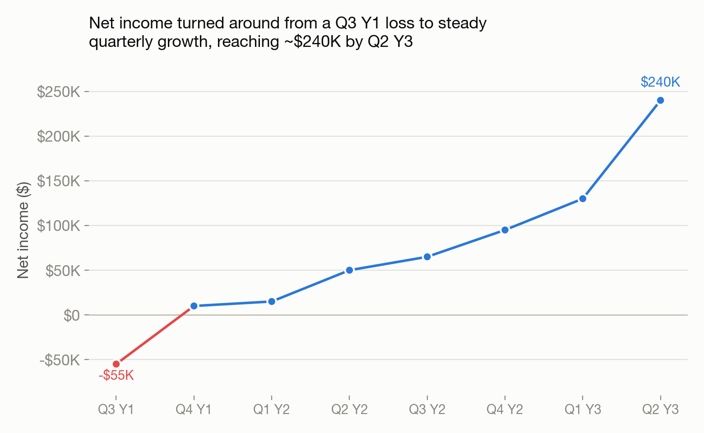

# JetPack Business Simulation: Team Golf

A competitive business simulation where the team ran a manufacturing firm (the "JetPack" sim) and made integrated market, operations, and financing decisions to drive financial performance over multiple periods.

Team project for the **FIN1 Finance Specialization** at Hult International Business School.

---

## The problem

Run a company in a competitive simulated market: decide which products and markets to compete in, how to invest in capacity and R&D, and how to fund growth — then live with the financial results each period.

## The approach

- **Market & contract strategy:** rather than chasing the crowded "green jetpack" order book, the team pivoted to acquire the markets of the other three products and pursued contracts that paid out later.
- **Capital investment:** outsourced factories early to keep costs low, then bought a single factory to support R&D on the "Sporty Jetpack" and cut its production cost.
- **Production:** prioritized R&D improvements on existing products over rushing into new markets.
- **Financing:** issued bonds to cover cash deficits and overdrafts, issued and later repurchased shares opportunistically, and paid dividends when cash allowed.

## Results

- **Turned a $55K quarterly loss (Q3 Y1) into $240K net income by Q2 Y3** — eight consecutive quarters without a down quarter after the initial loss.
- **R&D investment:** completed the Basic ($50K), Sporty ($200K), and Green ($250K) jetpack product lines, plus a $80K waste-reduction upgrade — funding efficiency improvements on existing products rather than chasing new markets.
- **Financing mix:** two bonds issued (a $100K tranche, later repaid, and a $1M tranche in Q2 Y3), both at 2% interest per quarter, alongside opportunistic share issuance/buybacks as cash allowed.

## Deliverables

- [`jetpack_simulation_presentation.pdf`](jetpack_simulation_presentation.pdf) — the strategy deck covering rationale, analysis, and evaluation across market, capital, production, and financing decisions.

## Stack

- Business simulation, corporate finance (capital investment, bonds/equity, dividend policy)
